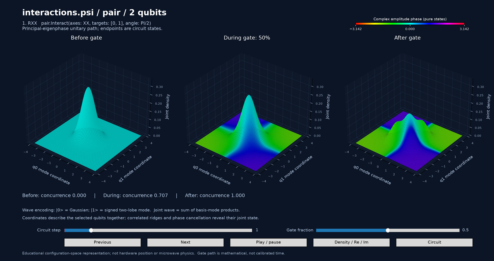
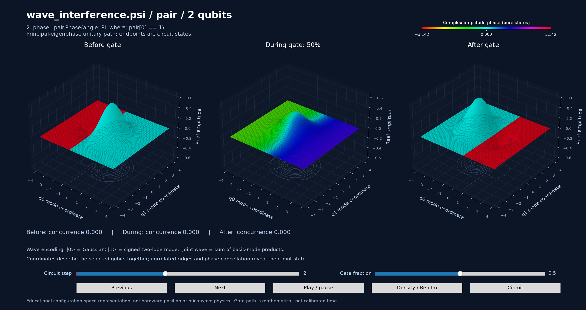
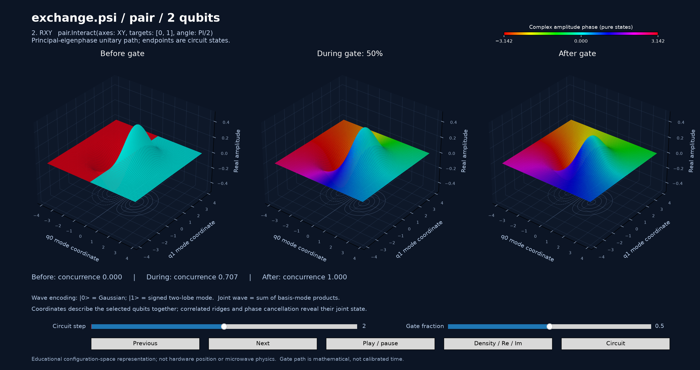
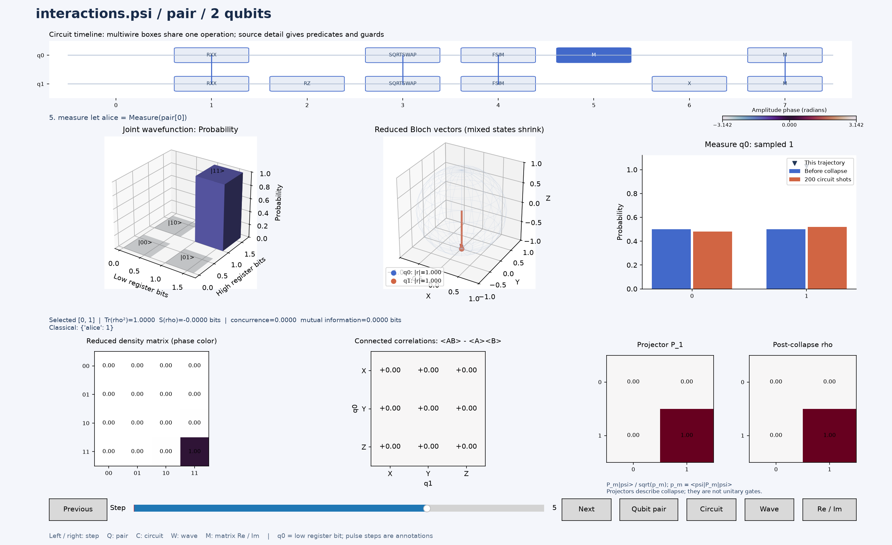

# qscript (v1.2)

qscript is a concept-phase quantum description language. Its logic layer sculpts
amplitudes with **Superpose, Phase, Reflect, and Flip**; its separate analog layer
describes pulse timing and frame metadata. The Python tools provide ideal logic
simulation, experimental OpenQASM 2.0 export, pulse scheduling, and educational
visualization. They do not execute hardware or simulate microwave physics.

```psi
let pair = Register(2);
pair.Superpose(targets: 0);
pair.Flip(target: 1, where: pair[0] == 1); // Bell pair
let bit = Measure(pair[0]);
pair.Flip(target: 1, when: bit == 1);     // classical correction
```

`where:` selects quantum basis states. `when:` evaluates classical outcomes.
Register bitstrings print `|q[n-1] ... q[0]>`: q0 is the least significant bit.
Phase tagging changes complex amplitudes; it does not by itself remove probability.

## Gates and two-qubit interaction

Every gate in the tables of the [requested gate list](https://en.wikipedia.org/wiki/List_of_quantum_logic_gates)
has an analytic matrix and an implementation through the existing primitives.
`Gate`, `Turn`, and `Interact` provide convenient notation while expanding into
Superpose/Phase/Flip. No new irreducible gate is required.

```psi
let q = Register(3);
q.Turn(axis: Y, target: 0, angle: PI/3);
q.Interact(axes: XX, targets: [0, 2], angle: PI/2);
q.Gate(name: FSIM, targets: [2, 1], theta: PI/5, phi: PI/6);
q.Gate(name: CCX, targets: [0, 1, 2], inverse: true);
```

The catalog includes Pauli/H/S/T/SX, phase and general U rotations; controlled
and anticontrolled gates; XX/YY/ZZ/XY interactions; SWAP, iSWAP, roots and powers;
Barenco, Berkeley B, canonical entanglers, DB, ECR, fSim, Givens, Magic,
Sycamore, CZS, Deutsch, Margolus, Peres, Toffoli, Fredkin and fermionic Fredkin.
All entries support adjoints. See the [complete gate and matrix reference](explain/gate-reference.md)
for names, parameters, matrices, decomposition rules, source links and conventions.

The first ordered gate operand is the most significant **local matrix** bit;
CX `[0,2]` controls q0 and targets q2. RXY is the XX+YY exchange interaction,
with `exp[-i angle (XX+YY)/4]`. FSIM follows Google's `exp(-i phi)` convention;
the linked Wikipedia table's FSIM row has the opposite sign. The reference
explains how to translate it.

## Animated 3D wavefunctions

Install the optional viewer dependencies in your Python environment:

```sh
python3 -m pip install -r requirements-viewer.txt
python3 viewer-references/psi_interference_viewer.py qscripts/interactions.psi --step 1
```

The default **wave lens** shows continuous before/during/after wave surfaces.
Drag **Gate fraction** or press **Play / pause** to watch a unitary change the
joint wave; switch Density / Re / Im to see its probability, signed lobes and
phase. Previous/Next selects a circuit operation, and Circuit switches scripts.
Use `--step 1` to start at the first gate and `--wave-mode real` for signed waves.

The display uses an explicit orthonormal mode encoding:
`phi0(x) = pi^(-1/4) exp(-x²/2)`, `phi1(x) = sqrt(2) x phi0(x)`.
For two qubits, `Psi(x,y) = sum_ab c_ab phi_a(x) phi_b(y)`.
Gates act on the actual coefficients: phase changes alter interference, exchange
moves amplitude between modes, and entangled states cannot factor into two
independent waves. The axes are chosen configuration coordinates, not the
physical positions of hardware qubits. Between gates, the animation uses a
principal-eigenphase unitary path; it does not claim a calibrated pulse trajectory.
Mixed reduced states show joint density, and measurement jumps at the endpoint.

```sh
python3 viewer-references/psi_interference_viewer.py qscripts/interactions.psi --step 1
python3 viewer-references/psi_interference_viewer.py qscripts/exchange.psi --step 2 --wave-mode real
python3 viewer-references/psi_interference_viewer.py qscripts/wave_interference.psi --step 2 --wave-mode real
```

**XX interaction:** a separable Gaussian becomes an entangled joint wave. The
three surfaces use a shared vertical scale and show before, halfway and after.



**Phase tagging:** a relative phase reshapes the signed wave without changing
computational-basis probabilities. The following Hadamard decodes it (H Z H = X).



**XY exchange:** amplitude moves between the 01 and 10 modes; the signed surfaces
show their combined wave rather than independent per-qubit waves.



## Diagnostic workbench

Select `--view workbench` to inspect matrices, Bloch vectors and measurements.



Screenshots are captured from the actual viewer. Regenerate them with
`python3 assets/generate_screenshots.py` after installing viewer dependencies.

The workbench shows a circuit timeline, a 3D joint wavefunction (probability and
phase, or real/imaginary amplitude), reduced Bloch vectors and density matrices,
connected Pauli correlations, pair concurrence, mutual information, and
measurement probabilities before collapse. The state panels show the resulting
collapsed trajectory. Matrix panels compare the analytic gate against its actual
primitive expansion, with real/imaginary views and numerical errors. Measurement
steps show the sampled projector and resulting reduced state.

- Left/right or Previous/Next steps through operations.
- Q / Qubit pair cycles wire pairs; `--qubits` chooses the initial one or two wires.
- W / Wave switches probability, real amplitude and imaginary amplitude.
- M / Re / Im switches the matrix component.
- C / Circuit switches between supplied scripts. Each circuit has its own state.

```sh
# Compare circuit walkthroughs.
python3 viewer-references/psi_interference_viewer.py --view workbench qscripts/interactions.psi qscripts/exchange.psi --shots 500 --seed 1

# Inspect a chosen step, save a view and export all numerical diagnostics.
MPLBACKEND=Agg python3 viewer-references/psi_interference_viewer.py --view workbench qscripts/interactions.psi --step 1 --save build/interaction.png --report build/interaction.json --no-show

# Compare complete reference/primitive circuit matrices and equivalent circuits.
MPLBACKEND=Agg python3 viewer-references/psi_interference_viewer.py --view workbench qscripts/bell_unitary.psi qscripts/bell_primitives.psi --unitary --report build/bell-comparison.json --no-show

# Explore a basis input and compare the QFT against its theoretical matrix.
python3 viewer-references/psi_interference_viewer.py --view workbench qscripts/qft_3.psi --initial 101 --unitary --report build/qft.json

# Print catalog entries or a full complex local matrix.
python3 viewer-references/psi_interference_viewer.py --view workbench --list-gates
python3 viewer-references/psi_interference_viewer.py --view workbench --matrix RXX --params PI/2
```

`--register` chooses one declared register. `--initial` is a high-bit-first basis
bitstring (the Python simulator also accepts normalized complex arrays). `--shots`
reruns the complete circuit, including intermediate measurements and classical
corrections. Reports retain full complex matrices, distributions and reductions;
plots cap basis bars at 128 and histogram outcomes at 16. `--unitary` requires
unitary operations without measurements, guards or pulse annotations and is
limited to eight qubits. Statevector storage and snapshots grow exponentially.

The [standalone wave viewer](viewer-references/wave_viewer.py) remains a separate
analytic spatial illustration; run `python3 viewer-references/wave_viewer.py`.
Register amplitudes in the circuit workbench are not a spatial wavefunction.

## OpenQASM and pulse schedules

Parser, gate references, compiler and pulse scheduler require only Python's
standard library. Named gates lower through the same primitive expansions as the
simulator. The compiler supports same-register conjunctive controls, clean
ancilla chains, and classical `measured_register == integer` conditions. Unsupported
logic predicates/guards raise errors; they do not silently become unconditional
gates. OpenQASM 2 omits global phase and documents the omission in comments.

```sh
python3 compiler/qasm_compiler.py qscripts/interactions.psi --out build/interactions.qasm
python3 compiler/qasm_compiler.py qscripts/teleport.psi --out build/teleport.qasm
python3 compiler/qasm_compiler.py qscripts/ghost_filter.psi --pulse-table --simulate-bloch
python3 compiler/qasm_compiler.py qscripts/ghost_filter.psi --pulse-json build/ghost_filter.json
```

```psi
let memory = Register(1);
Analog(target: memory[0]) {
    Rotate(axis: X, angle: PI/2, duration: 20ns, shape: Gaussian(sigma: 4ns));
    Wait(duration: 10ns);
    ShiftPhase(angle: PI/8);
}
```

Analog blocks describe explicit pulse time; Align branches start together and
advance by the longest duration. Pulse schedules retain waveform/frame/readout
metadata. The optional Bloch backend replays ideal independent rotations and
phase shifts. It has no transfer from preceding logic states, entanglement,
noise, envelope synthesis or hardware calibration. Pulse operations are comments
in QASM and annotations in the circuit statevector viewer.

## References, tests, and implementation boundaries

- [Language manual](qscript-Definition.md): a beginner walkthrough, amplitude/phase explanations, and implemented syntax versus planned pulse bridging.
- [Primitive gate recipes](qscript-Definition.md#7-reading-primitive-recipes): execution-order expansions for the full catalog, including two-qubit interactions and controlled rotations.
- [Example guide](qscripts/EXAMPLES.md): circuits, algorithms and their limitations.
- [Gate/matrix reference](explain/gate-reference.md): complete catalog and math.
- [Agent handbook](AGENTS.md): owners, contracts, known gaps and planned work.
- `psi_lang.py`: shared syntax and records; `quantum_gates.py`: matrices/synthesis.
- `quantum_simulator.py`: statevectors and diagnostics; `compiler/qasm_compiler.py`: QASM and pulse tools.

```sh
python3 -m unittest discover -s tests -v
```

The standard-library tests check parsing, scheduling, ideal pulse replay, all
named gate expansions and QASM equivalence using an independent instruction
evaluator. NumPy/Matplotlib tests check logic evolution, measurement, density
matrices, examples and Agg viewer rendering; these skip if optional dependencies
are unavailable. No external QASM conformance or hardware validation is claimed.

Multiline calls work. Unknown general blocks still do not implement loops,
conditionals or function definitions; use explicit operations and `when:`.
Complex OR predicates work in the ideal simulator but are rejected by QASM.
One register is simulated/compiled at a time; cross-register predicates are
rejected. Expressions use Python evaluation and are for trusted local scripts.
Custom `def pulse` / `.apply` remains planned. See [LICENSE](LICENSE) for MIT terms.
